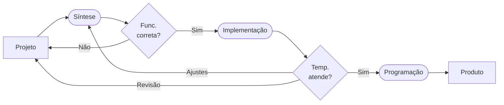

# Kits de FPGAs

!!! note 
    Neste tutorial estão informações sobre a tecnologia dos FPGAs, as ferramentas usadas para programá-los e alguns kits disponíveis. 

Um FPGA (Field-Programmable Gate Array) é um chip reprogramável que permite implementar circuitos digitais personalizados. Ao contrário de um processador (que executa instruções), o FPGA configura sua lógica interna para se tornar o circuito desejado.

## Características principais:

  * Composto por blocos lógicos programáveis e interconexões configuráveis.
  * Pode implementar desde circuitos simples como um contador, uma UART, até sistemas complexos, processadores, aceleradores de IA, etc.
  * É reprogramável, você pode alterar a lógica quantas vezes quiser, diferente de um ASIC que é fixo.

## Aplicações comuns:
  
  - Prototipagem de hardware;
  - Processamento de sinais digitais;
  - Aceleradores de IA, visão computacional e redes;
  - Sistemas embarcados (SoC com processador + lógica dedicada).

## Fluxo de desenvolvimento

Em linhas gerais, o desenvolvimento usando FPGAs segue o seguinte fluxo: 

O projeto é especificado geralmente em uma HDL, por exemplo, Verilog. Se a ***síntese*** for bem sucedida, é possível verificar a operação do circuito e saber se ele funciona corretamente, considerando apenas suas entradas e saídas, sem se preocupar ainda com a temporização. Esta etapa, chamada de RTL, gera um circuito lógico ainda independente da tecnologia alvo. A fase de ***implementação*** mapeia e roteia o circuito para um dispositivo específico. Após ela é possível saber se os requisitos temporais foram atingidos (e. g. frequência máxima). Em caso contrário, será necessário: **(i) ajustar** parâmetros de síntese, incluindo requisitos mais específicos; ou **(ii) revisar** o projeto para otimizar determinadas partes. Um vez que o circuito atende a especificação, a ***programação*** do dispositivo é feita diretamente no FPGA (que é volátil) ou em uma memória *flash* que fornecerá o *bitstream* ao FPGA sempre que a placa for ligada. 

!!! example "Minicurso"
    O Prof. Menotti ministrou um minicurso sobre o tema, [neste link](https://github.com/menotti/fpga) você encontra o material e as gravações. 

## Ferramentas de síntese

Em geral, os kits de FPGAs requerem o uso das ferramentas próprias do fabricante descritas a seguir. Alguns poucos dispositivos permitem o uso de ferramentas FOSS, descritas na [última subseção](#yosys).

### [Quartus](https://www.altera.com/products/software-tools/quartus-prime)

[Template](https://github.com/menotti/ld/) para usar com linha de comandos. 

### [Vivado](https://www.amd.com/en/products/software/adaptive-socs-and-fpgas/vivado.html)

[Template](https://github.com/arruk/vivado-tcl-template) para usar com linha de comandos. 

### [Yosys](https://yosyshq.net/yosys/)

## Kits de FPGAs

A seguir estão alguns dos kits disponíveis em nosso grupo, mas fique à vontade para adicionar outros. 

### [DE0-CV (Altera)](https://www.terasic.com.tw/cgi-bin/page/archive.pl?Language=English&CategoryNo=163&No=921)

### [DE10-standard (Altera)](https://www.terasic.com.tw/cgi-bin/page/archive.pl?Language=English&CategoryNo=165&No=1081)

### [Tang Primer 20k (Sipeed/Gowin)](https://wiki.sipeed.com/hardware/en/tang/tang-primer-20k/primer-20k.html)

### [Zybo Z7-20 (Xilinx)](https://digilent.com/reference/programmable-logic/zybo-z7/start)

### [Alinx AX7350B (Xilinx)](https://www.en.alinx.com/Product/SoC-development-Boards/Zynq-7000-SoC/AX7350B.html)

A ALINX AX7350B é uma placa de desenvolvimento baseada no Xilinx Zynq-7000 XC7Z035, que reúne um processador ARM Cortex-A9 de dois núcleos e uma FPGA no mesmo chip. 
Essa combinação permite desenvolver software no sistema de processamento (PS) e circuitos digitais na lógica programável (PL). 
A placa oferece recursos como memória DDR3, Ethernet, HDMI e interfaces de expansão, permitindo explorar desde exemplos com LEDs até projetos de processamento de dados e comunicação. 

A tabela apresenta alguns dos principais recursos, conforme o 
[datasheet do XC7Z035](https://docs.amd.com/api/khub/documents/juMnxca71Tf2gfjmNyjM8A/content) e as 
[especificações da placa](https://www.en.alinx.com/Product/SoC-development-Boards/Zynq-7000-SoC/AX7350B.html):

| Recurso | Especificação |
| --- | --- |
| Dispositivo | Xilinx Zynq-7000 XC7Z035 |
| Processador | ARM Cortex-A9 de dois núcleos, até 800 MHz |
| Células lógicas programáveis | 275.000 |
| LUTs | 171.900 |
| Registradores da PL — flip-flops | 343.800 |
| Memória interna da PL — Block RAM | 17,6 Mbit, distribuídos em 500 blocos |
| Blocos DSP — operações aritméticas | 900 |
| Memória DDR3 da placa | 2 GB: 1 GB conectado ao PS e 1 GB à PL |
| Armazenamento eMMC | 8 GB |
| Memória QSPI Flash | 32 MB |
| Oscilador para a lógica da PL | 50 MHz |

Para começar a desenvolver projetos para a **ALINX AX7350B**, utilize o [vivado-tcl-template](https://github.com/arruk/vivado-tcl-template), disponível no GitHub. 
Ele oferece uma estrutura inicial com um exemplo de controle dos LEDs da placa e comandos de terminal que facilitam a compilação e a programação da FPGA. 
O projeto também pode ser aberto na interface gráfica do Vivado.

O repositório funciona como um **template**: você pode criar seu próprio repositório a partir dele e adaptar os arquivos para desenvolver um novo projeto. 
Consulte o **README** para conhecer os requisitos, preparar o ambiente e entender como compilar, programar a placa e modificar o exemplo. 
